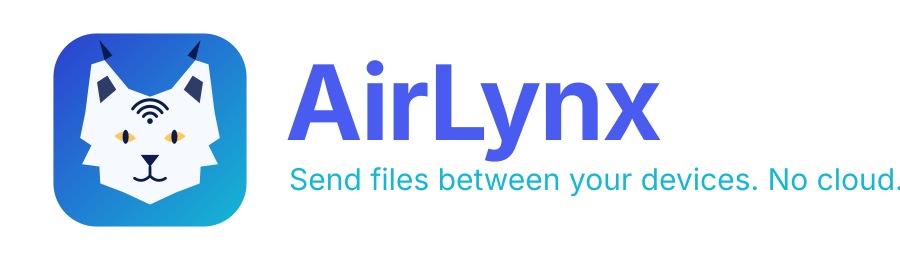
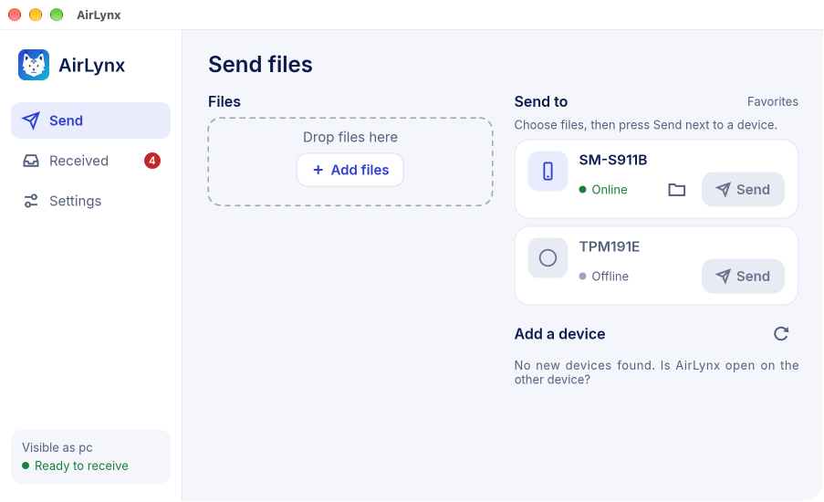

<p align="center">
  
</p>

<p align="center">
  Send files between your phone, TV and computer over your own Wi-Fi.<br>
  No account, no cloud, no cable.
</p>

<p align="center">
  <b>Android</b> &middot; <b>Android TV</b> &middot; <b>macOS</b> &middot; <b>Linux</b> &middot; <b>Termux</b>
</p>

<p align="center">
  
</p>

---

## Why AirLynx

- **Private.** Files go straight from one device to the other on your local network. Nothing is uploaded anywhere.
- **Automatic.** Devices find each other on their own. Open the app on both and they show up.
- **Safe by default.** A device only accepts files from devices you have added as favorites.
- **Encrypted and checked.** Every transfer is encrypted, and every file is verified with a SHA-256 hash on arrival.
- **Always ready.** While the app is open it is receiving. There is no accept prompt for devices you trust.
- **Works from the Share menu.** On Android, share a photo, file or text from any app straight to AirLynx.

## How AirLynx compares

AirDrop is great if everything you own is Apple.
[LocalSend](https://localsend.org) is a good open-source, cross-platform choice. AirLynx exists for the cases where
they fall short: mixed households with Android phones, TVs and Linux boxes, and networks that make discovery hard.

**What sets it apart**

- **It finds devices where LocalSend gave up.** On one test network, the Mac and the phone sat in different /24
  ranges of the same /16. LocalSend's multicast never arrived and its fallback scan only looks in its own /24, so the
  devices never saw each other. AirLynx found the phone straight away. The
  [full test write-up](LOCALSEND-DISCOVERY.md) has the evidence and the reasons.
- **Set it up once, then forget it.** Add each other as favorites and every later transfer is one tap, with nothing to
  accept. Strangers get nothing, because only favorites are allowed in.
- **Pull files, not just push them.** Need a photo that is on your phone? Open its folder from your computer and
  **Get** it, without touching the phone.
- **One app for the TV, the phone and the server.** The Android TV build works with the remote, and the same
  engine ships as a command line tool for Linux and Termux.

**Where the others are ahead.** AirDrop needs no install and needs no shared Wi-Fi. LocalSend runs on Windows and iOS,
which AirLynx does not (yet), and it is more mature. AirLynx also does not authenticate devices yet, see
[Status and privacy](#status-and-privacy).

## Get started in three steps

1. **Install AirLynx** on two devices that are on the same Wi-Fi (see [Install](#install)).
2. **Add each other as favorites.** Open the **Send** tab, find the other device under **Add a device** and tap **Add**.
   Do the same on the other device. When both have added each other, its card shows **Online**.
3. **Pick files and tap Send.** The files arrive in the other device's save folder.

> **Why favorites?** Each install has a random device ID, and AirLynx only accepts files from devices you added.
> A stranger on a cafe network cannot push files at you. If an unknown device does try, you see a request on the
> **Received** tab with an **Add favorite** button.

## Install

GitHub Actions builds every platform on each push to `main`. Open the latest run under the **Actions** tab and download the
artifact: `airlynx-macos-arm64`, `airlynx-android` (both APKs) or `airlynx-linux-<arch>`. These are test builds, not
releases. To build it yourself you need [Rust](https://rustup.rs) 1.95 or newer.

### macOS

Unzip the artifact (Apple silicon) and drag `AirLynx.app` to Applications. The app is only ad-hoc signed, so the first
time, right-click it and choose **Open**. To build it yourself:

```sh
git clone https://github.com/jbrunemann/airlynx.git && cd airlynx
./scripts/bundle-macos.sh && open target/release/AirLynx.app
```

Received files go to `~/Downloads/AirLynx`. macOS may ask for Local Network access the first time. Allow it, or
AirLynx cannot find your other devices.

### Android and Android TV

Needs Android 11 or newer. Install `AirLynx.apk` from the artifact (or `AirLynx-armv7.apk` on a 32-bit TV). A newer build installs over an older one and keeps
your favorites, as long as both are signed with the same key (all CI builds are).

To build it yourself you need the Android SDK and NDK (see [the developer guide](docs/DEVELOPING.md#toolchain-and-environment)):

```sh
./scripts/build-apk.sh --install      # builds the APKs and installs the arm64 one over adb
```

The build produces two APKs in `target/release/apk/`: `AirLynx.apk` (64-bit phones and tablets) and
`AirLynx-armv7.apk` (many TVs have a 32-bit system).

After installing, open the app and tap **Grant file access**, then enable "All files access". The in-app file
browser needs it, and received files then land in `Download/AirLynx`. Without it they go to
`Android/data/dev.airlynx.app/files/received`.

On a TV, use the remote's arrow keys and OK. Most TVs have no screen for that permission, so grant it from a
computer: `adb shell appops set dev.airlynx.app MANAGE_EXTERNAL_STORAGE allow`.

### Linux

Download the `airlynx-linux-x86_64` or `airlynx-linux-aarch64` artifact, or build it
yourself (`./scripts/bundle-linux.sh`, or `./scripts/build-linux-docker.sh` from a Mac). Then:

```sh
tar xzf airlynx-linux-<arch>.tar.gz && cd airlynx-linux-<arch> && ./install.sh
```

This installs into `~/.local` and adds AirLynx to your menu under Internet. `./install.sh --uninstall` removes it.
It needs glibc 2.35 or newer, plus `sudo apt install libxkbcommon0 libgl1` on Debian and Ubuntu.

### Termux (command line only)

To run AirLynx inside Termux without the APK, see [the Termux notes](docs/DEVELOPING.md#quick-start).

## Using the app

| Page | What it does |
|------|--------------|
| **Send** | Choose files, then tap **Send** on an online favorite. Its card shows a progress bar and **Cancel**. Files the other side has verified disappear from your list. Failed or cancelled ones stay so you can retry. |
| **Received** | Incoming transfers, requests from unknown devices, and a history of what arrived. **Open** a file, or on desktop click its icon to copy its full path. |
| **Settings** | Rename this device, change the save folder, and manage or remove favorites. **Info** shows a favorite's address, route and when you last saw it. |

**Browse another device.** A favorite that has added you also shows a folder button. It opens that device's save
folder so you can look around and **Get** files from it. This is read only.

Dark mode follows your system setting. Narrow windows (phones) get a bottom tab bar, wide ones a sidebar.

## Command line

The same engine ships as a CLI, handy for servers, scripts and Termux. It shares its identity and favorites
with the desktop app.

```sh
airlynx receive --dir ./received          # wait for files
airlynx discover                          # list devices on the network
airlynx favorite add "Pixel"              # by name or ID prefix
airlynx send a.jpg b.pdf --device Pixel   # or --to 192.168.1.20
airlynx browse --device Pixel             # list a favorite's save folder
airlynx get docs/a.pdf --device Pixel -o .
```

From a checkout, prefix each command with `cargo run --release -p airlynx --`.

## Troubleshooting

- **The other device does not show up.** Both need to be on the same Wi-Fi. Guest networks and some routers block
  traffic between devices ("client isolation"). On macOS, check System Settings > Privacy & Security > Local Network.
- **It shows up but is offline.** Open AirLynx on the other device and keep it open. A device counts as online for
  20 seconds after it last answered.
- **Nothing arrives on a locked Android phone.** While the app is open, a foreground service with a notification
  keeps it receiving. Do not swipe the app away.
- **A received file has `(1)` in its name.** AirLynx never overwrites. A second file with the same name gets a number.

## Status and privacy

AirLynx is a working prototype (v0.3.0). It has been tested between two CLI profiles on one Mac, on an Android
emulator and on a TV (the interface only), but not yet on a physical phone. Expect rough edges.

Transfers are encrypted, but devices are not yet authenticated. A favorite is recognized by its device ID, so someone
on your network who learns that ID could pretend to be that device. Use AirLynx on networks you trust. A pairing step
with a short code is planned. Discovery messages are not encrypted.

## For developers

AirLynx is a Rust workspace: a core library (discovery, protocol, encryption), a CLI, and one egui app for desktop and
Android. **[docs/DEVELOPING.md](docs/DEVELOPING.md)** has the repository layout, wire protocol, UI design,
build and test workflow, gotchas and roadmap.

```sh
cargo test --workspace
cargo clippy --workspace
```

Two side notes: [LOCALSEND-DISCOVERY.md](LOCALSEND-DISCOVERY.md) explains why LocalSend could not find devices on one
test network and AirLynx could, and [SMB-GATEWAY.md](SMB-GATEWAY.md) is a spike for showing devices under Network in Finder.
